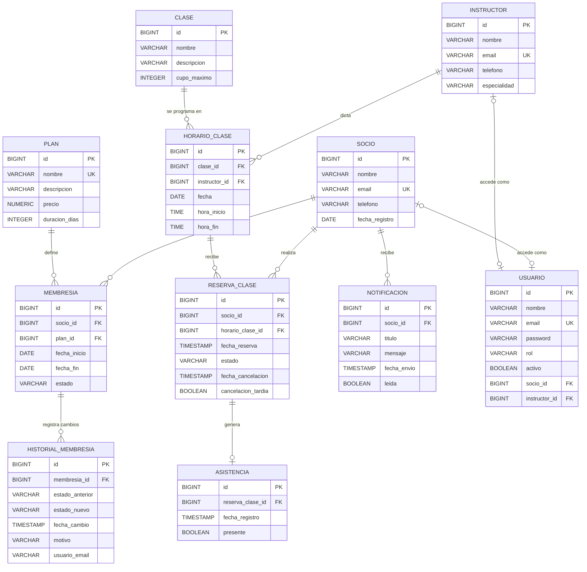

# FitClub

- Sistema académico full-stack para la gestión de un gimnasio o centro deportivo: socios, planes, membresías, instructores, clases, horarios, reservas, asistencia y notificaciones.
- **Proyecto PA-08 — Membresías, Clases y Reservas de Centro Deportivo** · Programación Aplicada · Gestión 2026-2.

## 1. Problema

- Un gimnasio que gestiona su operación de forma manual o dispersa (planillas, cuadernos, mensajes sueltos) no tiene una fuente única y validada de quiénes son sus socios ni qué membresía tiene cada uno, por lo que es fácil duplicar registros o dejar datos incompletos.
- No hay visibilidad de qué membresías están vigentes, por vencer o vencidas.
- Las clases (horarios, cupos, instructores) se coordinan sin un sistema que evite choques de horario o sobrecupo, y no queda registro confiable de la asistencia.
- No existe un mecanismo para notificar a un socio, por ejemplo, que su membresía está por vencer o que una clase reservada cambió de horario.

## 2. Objetivo del MVP

- Construir un sistema web que centralice el registro y control de socios, membresías, clases, horarios, reservas y asistencia, con datos validados, relaciones consistentes entre entidades y una API REST documentada que pueda consumir cualquier cliente (web o móvil).

## 3. Actores principales

- **Administrador** — gestiona usuarios, planes, instructores, clases y horarios; tiene acceso completo.
- **Recepción** — registra socios y membresías, gestiona reservas y asistencia en el día a día.
- **Instructor** — consulta sus horarios y registra la asistencia de sus clases.
- **Socio** — consulta sus membresías, reserva clases y recibe notificaciones.

## 4. Alcance inicial

El MVP obligatorio comprende los siguientes módulos:

- Socios
- Planes
- Membresías e historial de membresías
- Instructores
- Clases
- Horarios de clase
- Reservas de clase
- Asistencia
- Notificaciones
- Usuarios, roles y autenticación
- Dashboard y reportes

El equipo puede mejorar la experiencia de usuario o agregar facilidades, pero no puede eliminar componentes del alcance funcional cerrado sin autorización docente.

## 5. Fuera de alcance

- **Procesamiento de pagos reales:** prohibido explícitamente por las reglas de negocio del proyecto. El sistema registra el precio de planes y membresías, pero no cobra.
- Integraciones con servicios externos (pasarelas, mensajería SMS o correo real) que no formen parte del alcance funcional cerrado.

Cualquier exclusión concreta adicional deberá registrarse como supuesto o decisión del proyecto y validarse con el docente.

## 6. Stack objetivo del semestre

- Backend: Java 21 + Spring Boot (arquitectura hexagonal)
- Base de datos: PostgreSQL + Flyway
- Web: React + TypeScript + Vite
- Móvil: React Native + TypeScript
- Pruebas API: Postman / Swagger (OpenAPI)
- Pruebas frontend: Vitest + Testing Library
- Contenedores: Docker / Docker Compose
- Versionado: Git + GitHub
- CI: GitHub Actions
- IDEs: IntelliJ IDEA (backend), WebStorm (frontend), DataGrip (base de datos)

## 7. Estado actual

- **Primer parcial (backend):** modelo de dominio en Java, contrato de repositorio, Spring Boot con API REST, persistencia JPA en PostgreSQL, arquitectura hexagonal (puertos IN/OUT y adaptadores), relación 1:N Socio–Membresía, manejo global de errores (400, 404, 409, 500) y documentación Swagger.
- **Segundo parcial (frontend):** aplicación web en React + TypeScript que consume la API: navegación, formularios con validación, CRUD de Socio y Membresía, hooks reutilizables, búsqueda, filtros, paginación, modales y pruebas automatizadas.

## 8. Documentación

- `docs/01-vision/vision-v0.1.md` — visión, problema, objetivos y alcance.
- `Proyecto/Backend/Intellij/PruebaFitclub/README.md` — cómo levantar el backend, variables de entorno y migraciones.
- `Proyecto/Backend/Intellij/PruebaFitclub/src/main/resources/db/migration/` — scripts Flyway de la base de datos.
- `Pasos y guías/` — guías del equipo (Git, GitHub, IntelliJ, DataGrip, Postman, Swagger, arquitectura hexagonal, defensa individual).
- `LAbs/Mapas Conceptuales/` — mapas conceptuales por bloque temático.

### Cómo ejecutar el backend

```bash
git clone https://github.com/Javier758-ux/FitClub.git
```

1. Crear la base de datos en PostgreSQL (con DataGrip) según `Pasos y guías/DataGrip.md`.
2. Abrir `Proyecto/Backend/Intellij/PruebaFitclub` en IntelliJ y ejecutar `PruebaFitclubApplication`.
3. La API queda en `http://localhost:8080` y Swagger en `http://localhost:8080/swagger-ui/index.html`.

## 9. Regla de trabajo

Cada cambio importante debe ser comprensible, trazable y defendible. El repositorio es la fuente de verdad del proyecto.

- Commits claros que describan el cambio realizado.
- No subir contraseñas, tokens, archivos `.env` con secretos ni `node_modules/`.
- Antes de `git add .`, verificar que el `.gitignore` esté correctamente configurado.

## 10. Diagrama ER



## 11. Documentación Técnica

Toda la arquitectura del sistema, el tablero de trabajo, las decisiones del equipo y los incidentes y lecciones aprendidas se encuentran documentados en nuestro espacio de trabajo:

- [Ver Documentación Oficial en Notion](https://app.notion.com/p/3e68c96c494981ffa550ea4e3c061821)
- [Tablero de Proyecto en Notion](https://app.notion.com/p/e460159e6acb44ac98182893bc991c69)

## Integrantes del equipo

- Javier Caye
- Cristhian Arze
- Ricardo Mendoza
- Leonardo Aguilera
- Joshua Villagomez
- Joseline Zarza
