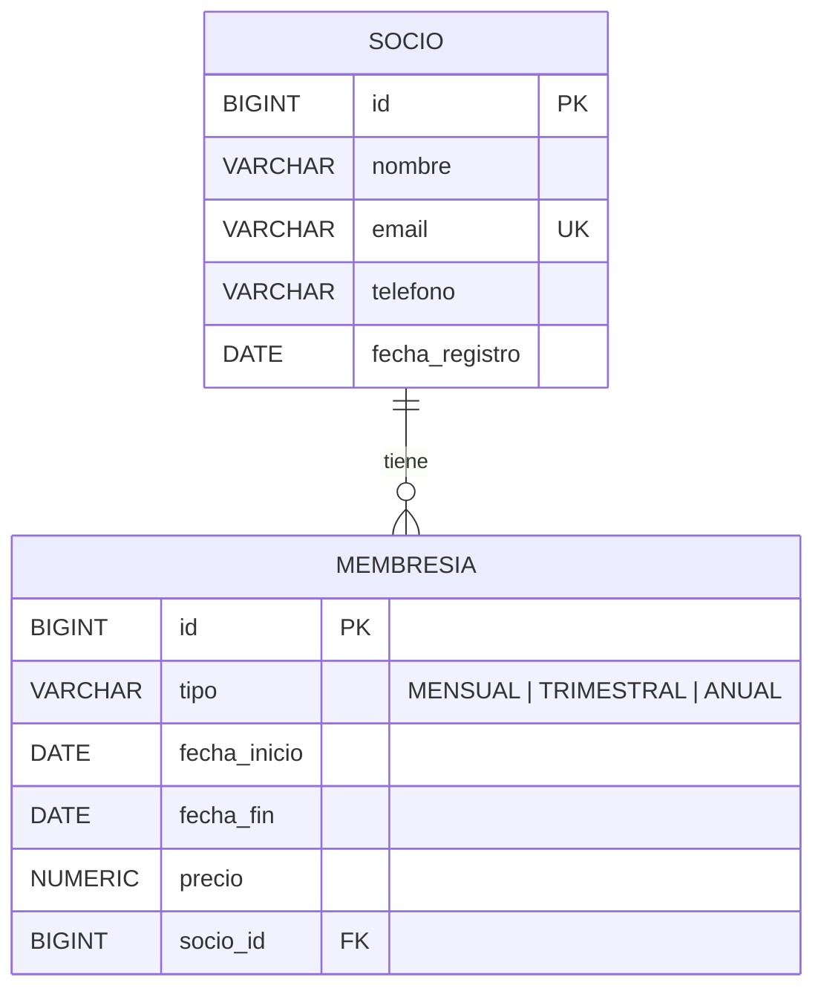

# FitClub

- Sistema académico full-stack para la gestión de **socios** y **membresías** de un gimnasio o centro deportivo.
- **Proyecto PA-08 — Membresías, Clases y Reservas de Centro Deportivo** · Programación Aplicada · Gestión 2026-2.
- Esta versión trabaja con **dos entidades relacionadas (Socio 1:N Membresía)** para demostrar la arquitectura completa de punta a punta: React → API REST → Spring Boot → PostgreSQL.

## 1. Problema

- Un gimnasio que registra a sus socios y sus membresías en planillas o cuadernos no tiene una fuente única y validada de quiénes son sus socios ni qué membresía tiene cada uno.
- Es fácil duplicar socios, dejar datos incompletos (correo o teléfono inválidos) o registrar membresías sin un socio real asociado.
- No hay visibilidad rápida de cuántos socios y membresías existen, de qué tipo son ni cuánto cuestan.

## 2. Objetivo del MVP

- Construir un sistema web que permita registrar y consultar socios y sus membresías con datos validados, garantizando que cada membresía pertenezca a un socio existente (relación 1:N con integridad referencial en la base de datos).

## 3. Actores principales

- **Personal del gimnasio (Administrador / Recepción)** — registra socios, registra membresías y consulta la información desde la aplicación web.
- **Socio** — persona inscrita en el gimnasio; es la entidad principal del sistema y puede tener varias membresías a lo largo del tiempo.

## 4. Alcance inicial

El MVP comprende los siguientes módulos:

- **Socios:** registrar, listar, buscar y consultar por id. Nombre, email único y teléfono de 7 a 10 dígitos.
- **Membresías:** registrar, listar, filtrar y consultar por id. Tipo (`MENSUAL`, `TRIMESTRAL`, `ANUAL`), fechas de inicio y fin, precio y socio dueño.
- **Dashboard:** total de socios, total de membresías, membresías mensuales y precio promedio.
- **Manejo de errores:** respuestas consistentes 400 (datos inválidos), 404 (no existe), 409 (conflicto, por ejemplo email duplicado) y 500.
- **Documentación de la API:** Swagger / OpenAPI.

### Endpoints de la API

| Método | Ruta | Descripción |
|---|---|---|
| `GET` | `/api/socios` | Lista todos los socios |
| `GET` | `/api/socios/{id}` | Consulta un socio (404 si no existe) |
| `POST` | `/api/socios` | Registra un socio (201) |
| `GET` | `/api/membresias` | Lista todas las membresías |
| `GET` | `/api/membresias/{id}` | Consulta una membresía (404 si no existe) |
| `POST` | `/api/membresias` | Registra una membresía para un socio existente (201) |

## 5. Fuera de alcance

- Autenticación, usuarios y roles (login).
- Planes, clases, instructores, horarios, reservas, asistencia y notificaciones.
- **Procesamiento de pagos reales:** prohibido por las reglas de negocio del proyecto. El sistema registra el precio de la membresía, pero no cobra.

Cualquier exclusión concreta adicional deberá registrarse como supuesto o decisión del proyecto y validarse con el docente.

## 6. Stack objetivo del semestre

- Backend: Java 21 + Spring Boot (arquitectura hexagonal: puertos IN/OUT y adaptadores)
- Persistencia: Spring Data JPA / Hibernate (`ddl-auto=validate`)
- Base de datos: PostgreSQL, schema `fitclub`
- Web: React + TypeScript + Vite + React Router
- Pruebas API: Postman / Swagger (OpenAPI)
- Pruebas frontend: Vitest + Testing Library
- Versionado: Git + GitHub
- IDEs: IntelliJ IDEA (backend), WebStorm (frontend), DataGrip (base de datos)

## 7. Estado actual

- **Backend:** API REST de Socio y Membresía con arquitectura hexagonal, validación con Jakarta Validation, persistencia JPA en PostgreSQL, relación 1:N Socio–Membresía, manejo global de errores (`GlobalExceptionHandler`), CORS configurado para el frontend y documentación Swagger.
- **Frontend:** aplicación web en React + TypeScript con layout y menú (Inicio, Socios, Membresías, Acerca), formularios controlados con validación, búsqueda, filtros, paginación, dashboard, `ErrorBoundary`, hooks reutilizables (`useAsyncList`) y pruebas automatizadas con Vitest.

## 8. Documentación

- `docs/01-vision/vision-v0.1.md` — visión, problema, objetivos y alcance.
- `Pasos y guías/` — guías del equipo (Git, GitHub, IntelliJ, DataGrip, Postman, Swagger, arquitectura hexagonal, defensa individual).
- `LAbs/Mapas Conceptuales/` — mapas conceptuales por bloque temático.

### Cómo ejecutarlo

```bash
git clone https://github.com/Javier758-ux/FitClub.git
```

1. **Base de datos (DataGrip):** conectado como `postgres`, crear el rol `pruebafitclub_admin`, la base `pruebafitclub`, el schema `fitclub` y las tablas `socio` y `membresia`. Como el proyecto usa `ddl-auto=validate`, Hibernate no crea tablas: la base es la fuente de verdad.
2. **Backend (IntelliJ):** ejecutar `PruebaFitclubApplication`. La API queda en `http://localhost:8080` y Swagger en `http://localhost:8080/swagger-ui/index.html`.
3. **Frontend (WebStorm):** crear `.env.development` con `VITE_API_URL=http://localhost:8080/api`, luego `npm install` y `npm run dev`. La aplicación queda en `http://localhost:5173`.

## 9. Regla de trabajo

Cada cambio importante debe ser comprensible, trazable y defendible. El repositorio es la fuente de verdad del proyecto.

- Commits claros que describan el cambio realizado.
- No subir contraseñas, tokens, archivos `.env` con secretos ni `node_modules/`.
- Antes de `git add .`, verificar que el `.gitignore` esté correctamente configurado.

## 10. Diagrama ER



- **Relación 1:N:** un socio puede tener muchas membresías; cada membresía pertenece a un solo socio.
- La clave foránea `socio_id` vive en la tabla hija (`membresia`) y referencia a `socio.id`.
- `email` es único: no se pueden registrar dos socios con el mismo correo (409 Conflict).

## 11. Documentación Técnica

Toda la arquitectura del sistema, el tablero de trabajo, las decisiones del equipo y los incidentes y lecciones aprendidas se encuentran documentados en nuestro espacio de trabajo:

- [Ver Documentación Oficial en Notion](https://app.notion.com/p/3e68c96c494981ffa550ea4e3c061821)
- [Tablero de Proyecto en Notion](https://app.notion.com/p/e460159e6acb44ac98182893bc991c69)

## Integrantes del equipo

- Javier Caye
- Cristhian Arze
- Ricardo Mendoza
- Leonardo Aguilera
- Joshua Villagomez
- Joseline Zarza
